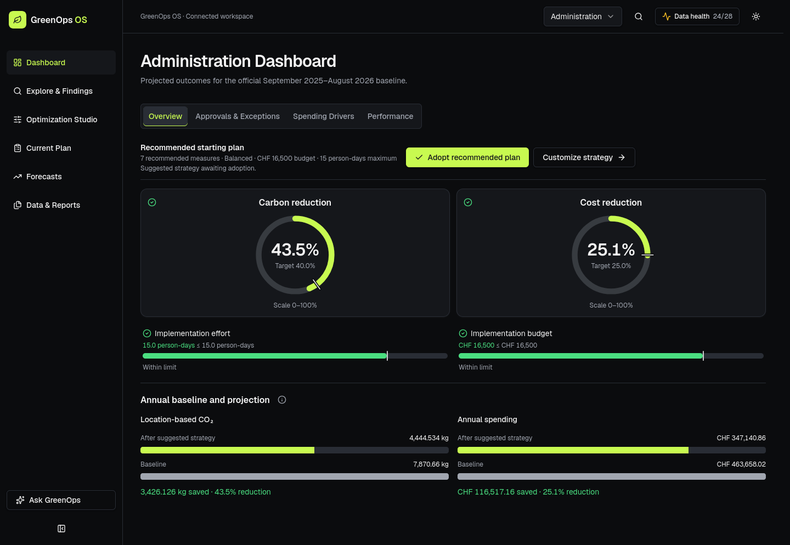
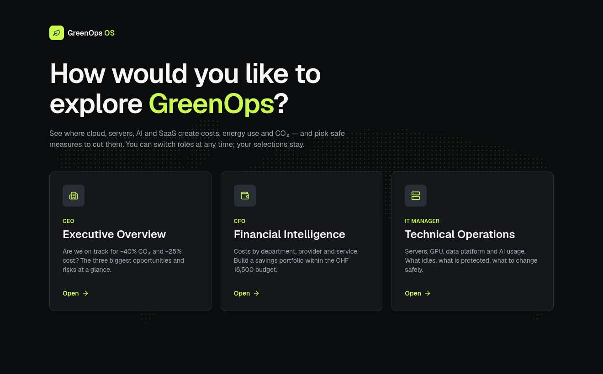

# GreenOps OS

[](https://github.com/yampolskytal/greenops-os-v5/actions/workflows/checks.yml)

**[Open the live dashboard →](https://greenops-os.lovable.app/)**

A Basel SME pays for cloud services, servers, AI and software licences. The electricity is used in Zurich, Frankfurt or Dublin, but the purchasing and operating decisions are made in Basel. GreenOps OS brings those bills and usage records together so IT, management and finance can see which departments and tools drive spending, electricity use and indirect (Scope 3) emissions.

Built for the **ALTYCA and Basel 2037** case at sprintd Basel, the prototype uses synthetic exports for a fictional consultancy of about 112 people: 13 core files and 15 bonus files, with bills in CHF, EUR and USD. Location-based carbon estimates use the grid mix where the service runs. For Switzerland, the [factor register](backend/factors.json) uses a consumption mix that accounts for imports and documents its source and range.

[](https://greenops-os.lovable.app/ceo)

For the September 2025–August 2026 baseline shown above, the seven recommended measures are projected to cut **location-based emissions by 43.5%** (target: 40%) and **annual spending by 25.1%** (target: 25%). Implementation uses the full **CHF 16,500**, or 15 person-days at CHF 1,100 each. These are estimates against the team’s baseline; the jury also checks submissions against its own reference baseline.

### One finding, one limit

- **Review unused licences.** The [August 2026 AI subscription export](backend/inputs/sprintd-basel-green-ai-data-main/ai_subscriptions.csv) lists 14 paid Microsoft Copilot seats for cost centre 4500, with nine active in the prior 30 days. At USD 21 per seat, the five inactive seats represent USD 105 per month to review. That is a candidate saving, subject to owner confirmation and contract terms.
- **Keep the idle recovery server.** [Ticket T-1094](backend/inputs/sprintd-basel-green-ai-data-main/it_tickets.csv) explicitly requires `dr-failover` to keep running even without load. Low utilization alone would give the wrong recommendation.

## Try a planning session

<details>
<summary>Preview the welcome page and its three role choices</summary>



</details>

1. **Start on the CEO dashboard.** Compare the cost and carbon targets with the recommended starting plan. Switch to CFO or IT Manager to inspect spending or resource usage behind the totals.
2. **Open Studio.** Change the budget or selection of measures and compare alternatives. Save an alternative as a Path to revisit it later.
3. **Adopt a Current Plan**, then open **Submission** to check and export the baseline and measures CSVs. Savings are projections for a fictional company; saving a plan on this device does not approve or execute infrastructure changes.

**From prototype to operations:** Pilot with one SME using read-only exports. Have finance reconcile the baseline against invoices and IT confirm protection windows and disputed records. Trial one approved measure, then compare subsequent bills and workload metrics with the estimate before expanding the rollout.

## Run locally

Use Node.js 22.12+ with npm and Python 3.11+ available as `python`. From the repository root, install the JavaScript dependencies once:

```sh
npm ci
```

**Terminal 1 — start the Python backend with the bundled challenge dataset:**

```sh
npm run backend
```

Wait for the backend at `http://127.0.0.1:8765`. If Python reports that `Europe/Zurich` is missing, run `python -m pip install tzdata` and restart it.

**Terminal 2 — start the web dashboard from the same repository root:**

```sh
npm run dev
```

Open **[http://127.0.0.1:8080](http://127.0.0.1:8080)**, or the local URL printed by Vite. Keep both terminals open: the dashboard forwards `/api/v2` requests to the Python process on port 8765. Press `Ctrl+C` in each terminal to stop. To explore the smaller demo dataset instead, use `npm run backend:demo` in terminal 1.

## Repository guide

| Location | What lives here |
| --- | --- |
| [`src/routes/`](src/routes/) and [`src/components/`](src/components/) | React and TanStack Start dashboards, planning tools and reports |
| [`src/lib/api/`](src/lib/api/) | Typed interface between dashboard views and the GreenOps API |
| [`backend/`](backend/README.md) | Python calculation engine, API, tests, CLI and classic dashboard |
| [`backend/engine/`](backend/engine/) | Ingestion, accounting, planning, forecasts, assistant and `/api/v2` mapping |
| [`backend/tests/`](backend/tests/) | Python regression and integration tests |
| [`backend/inputs/`](backend/inputs/) and [`backend/templates/`](backend/templates/) | Case datasets and official export formats |
| [`docs/`](docs/README.md) | API contract, deployment notes, audits and project history |

## Development checks

| Command | Checks |
| --- | --- |
| `npm run typecheck` | TypeScript types |
| `npm run lint` | Lint and code style |
| `npm test` | Frontend unit and component tests |
| `npm run test:backend` | Python backend tests |
| `npm run build` | Production dashboard build |

Making a change? The [contributor guide](CONTRIBUTING.md) shows where to edit calculations, API mappings and views, and how to test a change before opening a pull request.

**Dataset credit:** Sample data ALTYCA, sprintd Basel 2026. See the [organizer’s dataset and challenge brief](https://github.com/Fa-Bee/sprintd-basel-green-ai-data) for the data dictionary, example questions and submission requirements.
