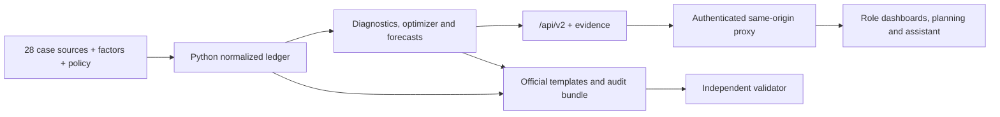

# GreenOps OS

[](https://github.com/yampolskytal/GreenOps-OS/actions/workflows/checks.yml)

**A digital cost, electricity and CO₂e decision tool for a Basel SME**

Sprintd Basel 2026 · GreenTech Edition · Green AI & Data challenge


[Open the live dashboard](https://greenops-os.lovable.app/) · [Run locally](#run-locally) · [Reproduce the submission](#reproduce-the-submission)

GreenOps brings cloud bills, server telemetry, AI usage and software contracts into one ledger. It shows where spend, electricity use and emissions come from, then proposes a package of changes under a cost and effort cap. A low-utilization server can be a savings opportunity or a protected disaster-recovery system. The decision depends on the bill, the workload and the applicable ticket.

The official case models a fictitious Basel company. The organizer supplied synthetic usage, infrastructure and contracts alongside selected public inputs such as exchange rates. The baseline covers **September 2025 through August 2026**, with evidence assessed as of **6 September 2026**. The case covers purchased digital services, infrastructure, data and AI. [Organizer requirements](backend/inputs/sprintd-basel-green-ai-data-main/README.md) · [Data dictionary](backend/inputs/sprintd-basel-green-ai-data-main/data_dictionary.md)

## Result at a glance

**The seven-measure planning package meets both targets at the scenario midpoints.** It uses the full implementation budget, clears the annual cost threshold by **CHF 602.65**, and requires owner sign-off on all seven measures. The owner-approved package is empty in a fresh official-data run.

| Jury criterion | Official-case result | Requirement |
| --- | ---: | ---: |
| Annual run-rate cost reduction | **CHF 116,517.16 · 25.13%** | At least 25% |
| Annual location-based CO₂e reduction | **3,426.13 kg CO₂e · 43.53%** | At least 40% |
| Annual electricity reduction | **8,918.84 kWh** | Reported for each measure |
| Implementation cost | **CHF 16,500** | At most CHF 16,500 |
| Implementation effort | **15 person-days** | At most 15 person-days |
| First-year gross savings | CHF 95,200.74 | Includes renewal and rollout timing |
| First-year net savings | CHF 78,700.74 | Gross savings less implementation cost |

The challenge compares **annual run-rate savings** with the baseline. First-year cash savings answer a separate question about when benefits arrive. The figures are modeled estimates for this case and depend on the pricing, workload and approval assumptions described below. [Submission requirements](backend/inputs/sprintd-basel-green-ai-data-main/README.md#submission-baseline-assumptions-and-package-of-measures) · [Reproduce these figures](#reproduce-the-submission)

| Baseline metric | Midpoint or observed total | Low to high scenario range |
| --- | ---: | ---: |
| Normalized observed spend | CHF 463,658.02 | Observed subtotal after FX and data adjudication |
| Estimated electricity | 39,828.20 kWh | 11,743.67–127,342.80 kWh |
| Location-based emissions | 7,870.66 kg CO₂e | 1,285.98–40,447.00 kg CO₂e |
| Market-based emissions on covered activity | 10,077.75 kg CO₂e | 2,222.73–42,764.30 kg CO₂e |

**Coverage matters.** The baseline contains **47,160 ledger rows**, including **114 without CHF** and **672 without estimated energy**. Rows without energy estimates account for about **CHF 124,058 in absolute observed spend**. Market factors cover **17,614.17 kWh**, or **44.23%** of the modeled electricity. The market estimate therefore describes a subset of activity. Each accounting view has its own coverage and should be read independently. [Factor configuration](backend/factors.json) · [Coverage and market evidence](#evidence-to-open)

## How the entry meets the challenge

| Requirement | What GreenOps does | Evidence for review |
| --- | --- | --- |
| **Connect** | Loads 13 core files and 15 bonus files through a schema registry. Normalizes dates, currencies, units, resources, regions and ownership. Maintains source row references and file fingerprints. | [Schema registry](backend/schema-v13.json) · [Ingestion and ledger](backend/engine/greenops.py) |
| **Find** | Ranks spending and footprint drivers and identifies unused seats, inactive compute, reruns, stale tables and unused reports. Separates estimated savings, actionable evidence and leads that still need investigation. | [Diagnostics](backend/engine/insights.py) · [Case measures](backend/engine/case_measures.py) |
| **Decide** | Simulates measures and searches compatible packages under both caps. Records annual and first-year outcomes, overlap, dependencies, target margins and approval requirements. | [Planning engine](backend/engine/planning.py) · [Optimizer and case reports](backend/engine/analytics.py) |
| **Know the limits** | Converts ticket-backed protections into rules. Flags data disagreements and hands unresolved decisions to a responsible owner. | [Case policy](backend/challenge-policy.json) · [Decision audit](docs/decision-audit.md) · [Verification](backend/engine/verification.py) |

### Data quality and calculations

1. **Import and attribution.** CSV and JSONL inputs from different systems are validated against the schema. Resource aliases and ownership mappings bring qualified cloud IDs, cost centres, tags and project aliases into the same ledger. Shared costs use documented monthly project hours where available, then FTE as a fallback. [Ingestion](backend/engine/greenops.py) · [Allocation and reconciliation](backend/engine/accounting.py)
2. **CHF.** Sum signed billed amounts in CHF using the invoice period’s FX evidence. Where available, the recorded CHF amount and rate evidence are retained for comparison. Final records and exact duplicate rules are applied before aggregation. Reconciliation compares provider summaries with invoice lines and AI invoices with gateway activity. A financial adjustment requires an explicit, evidenced decision. [Accounting logic](backend/engine/accounting.py) · [Input definitions](backend/inputs/sprintd-basel-green-ai-data-main/data_dictionary.md)
3. **Electricity.** Multiply resource activity by the relevant energy coefficient, then apply data-centre overhead to factors scoped to IT equipment. Inputs include vCPU-hours, node-hours, GPU-hours, storage and traffic volumes, and AI token activity. Model coefficients, workload utilization and PUE determine the low, midpoint and high cases. Ledger rows with insufficient activity evidence remain unavailable. [Factor file](backend/factors.json) · [Calculation evidence](backend/engine/evidence.py)
4. **Location-based CO₂e.** Multiply line-level kWh by the applicable regional grid factor and sum the corresponding scenarios. Zurich uses the Swiss consumption mix, which accounts for imports. The configured midpoint factors are **0.0894 kg CO₂e/kWh** for Switzerland, **0.374** for Germany, **0.308** for Ireland and **0.250** for mixed Europe. The mixed and unresolved geography assumptions are explicit proxies in the factor file. [Configured factors, ranges and source references](backend/factors.json)
5. **Market-based CO₂e.** Match covered activity to dated residual factors or eligible supplier evidence. Keep covered kWh, missing-factor rows, missing-energy rows and the assumptions beside each estimate. The API supplies separate observations by month, day and region where the data supports them. Procurement evidence is scoped by provider, region and date. [Market accounting](backend/engine/accounting.py) · [API integration](docs/integration/api.md)

The official run flagged **847 exact-duplicate events**, **145 contract-version events**, **60 AI invoice-to-gateway comparisons**, **6 runtime coverage mismatches** and **4 runtime contradictions**. The issue queue also tracks missing owners, invoice scope and project aliases such as `P004` and `P-004`. The evidence keeps the original source references and distinguishes a discrepancy from an approved ledger adjustment. [Normalization and audit](backend/engine/greenops.py) · [Review workflow](backend/engine/decision.py)

**Why “Servers” can show CHF 0.** The standalone category represents supplementary server telemetry. The relevant provider bills are already attributed to categories such as Cloud. The server line therefore contributes estimated electricity and CO₂e while the invoice remains the financial source. Inspect the resource and provider views for attributable spend. [Ledger and attribution](backend/engine/greenops.py)

### Selected measures

All savings below are annual scenario midpoints. The approver column identifies the roles responsible for reviewing each proposal.

| Measure | CHF/year | kWh/year | Location kg CO₂e/year | Days | Approval and scope |
| --- | ---: | ---: | ---: | ---: | --- |
| Auto-terminate and relocate the development cluster | 23,721.83 | 4,235.11 | 2,205.89 | 3 | **Head of IT.** Apply idle timeout first, then use the Zurich factor for eligible remaining usage. Preserve fixed jobs and quarterly training. Confirm the destination rate and migration dependencies. |
| Consolidate duplicate subscriptions | 23,446.74 | 0 | 0 | 1 | **Finance, IT and tool owners.** Verify feature parity and export the data. Count incremental savings after seat cleanup and the cost of retained licences. |
| Clean up unused SaaS and AI seats | 34,816.16 | 0 | 0 | 2 | **Finance and department licence owners.** Use three months of seat activity, retain a two-seat buffer and respect contract notice dates. |
| Schedule GPU on demand | 5,818.97 | 1,747.35 | 653.51 | 3 | **Head of Consulting.** Model a 55% reduction in billed GPU-hours outside protected windows. Verify warmup, queue deadlines, cooldown and rollback. |
| Schedule 12 Dublin test servers | 8,934.25 | 910.88 | 280.55 | 2 | **IT and workload owners.** Verify membership of the pooled bill. Preserve weekdays 08:00–18:00, March acceptance testing, Sundays and emergency wake-up. |
| Route routine AI calls and cache approved prefixes | 11,994.76 | 654.42 | 163.61 | 2 | **IT and AI product owners.** Benchmark model quality, actual tariffs and cache isolation. Count the higher supported savings scenario per workload to avoid an overlapping claim. |
| Autoscale surplus production workers | 7,784.45 | 1,371.08 | 122.57 | 2 | **Consulting, Finance and IT.** Pilot a minimum 75% worker floor. Keep service available and restore full capacity for closing, scheduled jobs and uncertain periods. |
| **Total** | **116,517.16** | **8,918.84** | **3,426.13** | **15** | **CHF 16,500 at CHF 1,100 per person-day** |

The optimizer treats overlapping billed scopes and exclusive alternatives as conflicts and enforces prerequisites. **Balanced** maximizes the smaller share of the two targets reached, then combined attainment and lower effort on ties. **Cost savings** prioritizes first-year net cash. **CO₂ reduction** uses conservative emissions estimates. Each run reports its search status. [Planning logic](backend/engine/planning.py) · [Selection algorithm](backend/engine/analytics.py) · [Measure evidence](backend/engine/case_measures.py)

**Sensitivity for the committee.** With the modeled savings numerator held fixed, the cost target clears up to a reference baseline of **CHF 466,068.64**. The equivalent location-based carbon threshold is **8,565.32 kg CO₂e**. A reference CHF baseline 1% above ours would leave a **CHF 556.49** shortfall. Varying only the Swiss consumption factor moves the modeled carbon reduction from **52.09%** at the low factor to **32.30%** at the high factor. The separate conservative stress test, which divides low package savings by the high overall baseline, gives **1.60%**. These sensitivities show where new evidence could change the conclusion. The jury’s uniform reference baseline has yet to be supplied. [Sensitivity and fallback evidence](#evidence-to-open)

### Protection and owner handoff

| Case | Protection decision | Ticket or evidence |
| --- | --- | --- |
| Disaster recovery `dr-failover` | Keep continuously available. The low load is consistent with an emergency standby role. | **T-1094** |
| Production `dp-prod` | Keep the service running. Protect the last three working days through approximately 04:00 and the fixed production jobs. | **T-1029**, job schedule, business calendar |
| Backup chain `st-backup` | Retain required backups for ten years and preserve restore safeguards. | **T-1039**, **T-1195** |
| Dublin test fleet | Keep available throughout the March 2026 release freeze. Preserve Sunday patch windows. | **T-1204** and Sunday patch tickets |
| Receivables audit report `pbi-07` | Keep available for the audit period. | **T-1167** |
| GPU and development-cluster dependency | Keep both resources available for quarterly training on the first three days of January, April, July and October. | **T-1053**, **T-1101** |

Hard blocks are excluded from the package. Conditional candidates retain a named responsible role and the missing evidence. The production pilot requires capacity-floor, deadline, closing rehearsal and rollback evidence before approval. The public site supports analytical requests and keeps operational approvals and changes with authorized operators. [Protection register](backend/challenge-policy.json) · [Review and readiness rules](backend/engine/decision.py) · [Published proxy](docs/integration/production.md)

## Three organizer questions

| Question | Answer in the official run |
| --- | --- |
| How many purchased AI seats were inactive in August 2026? | **67 of 157 seats**, representing **CHF 1,223.51 per month** at the billed seat shares. ChatGPT Team had 21 inactive out of 23 for CHF 423.99, Claude Team had 6 out of 34 for CHF 121.14, and Microsoft Copilot had 40 out of 100 for CHF 678.38. The calculation prorates unique final CHF bills by the inactive-seat share. |
| What does on-demand GPU operation bring? | **3 person-days / CHF 3,300** implementation. Modeled annual savings are **CHF 5,818.97**, **1,747.35 kWh** and **653.51 kg location-based CO₂e** at the midpoint. The CO₂e range is **123.01–1,717.71 kg**. The scenario uses removable billed GPU-hours, an energy factor, PUE and the German location factor, with training windows protected. |
| Can production be switched off at night and weekends? | **Keep production running.** Telemetry shows non-workday activity, the job list includes fixed morning deadlines and **T-1029** protects finance month-end closing. The Head of Consulting owns the decision with Finance and IT involved. A capacity-floor pilot can separately assess surplus-worker scaling. |

Try the questions in **Ask GreenOps** or inspect `questions.json` from the export. It records source rows, formulas and assumptions, including `ai_subscriptions.csv` and FX for seats, billing and telemetry for GPU, and the ticket, workload and calendar sources for production. [Organizer example questions](backend/inputs/sprintd-basel-green-ai-data-main/example_questions.md)

## Bonus features and evidence

| Bonus | Implementation and how to assess it |
| --- | --- |
| **Apertus assistant** | Optional Apertus routing translates questions into allow-listed analytical actions. Python calculates and renders the answers from the ledger. The assistant supports follow-ups, compact tables, source evidence and shortcuts to relevant views. The local rules also answer the official questions. The rehearsal compares assistant outputs with the same-run exports and can exercise the live endpoint with a German paraphrase, a follow-up and an operational request. [Assistant checks](backend/engine/assistant_check.py) · [Tool and data boundaries](docs/assistant-safety.md) |
| **Forecasts** | Compare one to three years with and without a plan. Forecasts use observed history where available, then a bounded growth scenario and documented dated changes. Eligible recurring infrastructure savings scale with workload after year one. Renewal and implementation timing affect the cash path. Ticket **T-1261** supplies the October 2026 production expansion from 20 to 24 nodes. August node-hour evidence supplies the modeled rate. A three-month holdout compares frozen and trailing means. Growth assumptions are written to the baseline template. [Forecast scenarios](backend/engine/forecast_scenarios.py) |
| **Market-based emissions** | Covered results appear in overview, historical and daily views, regional comparisons, supported measures and supported forecasts. The official geographic view shows available factors in Frankfurt and Dublin and a Swiss coverage gap. Forecasts carry supported residual-mix activity separately and depend on available factor evidence. [Market accounting](backend/engine/accounting.py) · [API mapping](backend/engine/frontend_api.py) |
| **Carbon-aware jobs** | A historical replay moves the eligible **Dev smoke test** from **10:00 to 13:00** within its working-day window, with a modeled midpoint reduction of **0.00584 kg CO₂e for that run**. The protected **Nightly ETL** remains at **02:00**. The signal is a German generation proxy. Live scheduling requires time-matched grid data and dated capacity, dependency and rollback clearance. Replay savings stay outside the package. [Replay provenance](backend/bonus-evidence/README.md) · [Scheduler](backend/engine/scheduler.py) |
| **CI waste** | Finds no-change builds and reruns and compares runner minutes with billed meters by month and region. A recoverable claim requires mapped billing and evidence the check can be skipped. The case flags review candidates and keeps CI savings outside the selected package. [Diagnostics](backend/engine/insights.py) · [Evidence joins](backend/engine/bonus_evidence.py) |
| **Usage clustering** | Groups similar server, SaaS, AI and job activity to help pick investigations. The diagnostics record a split-period stability check for server clusters. Compare the protected idle disaster-recovery server with a similarly idle system that warrants owner review. [Usage diagnostics](backend/engine/insights.py) |

### All 15 bonus inputs

The `bonus-decisions.json` report lists accepted rows, example row references and the decision or investigation supported by each source. All files below are under [`extra/`](backend/inputs/sprintd-basel-green-ai-data-main/extra).

| Bonus source | Role in the prototype |
| --- | --- |
| `data_platform_jobs.csv` | Fixed deadlines, flexible scheduling windows and protected production jobs |
| `data_catalog_tables.csv` | Cold-table and storage review candidates, with retention context |
| `powerbi_usage.csv` | Report refresh and view evidence, including audit exceptions |
| `ai_agent_runs.jsonl` | Agent retries, usage patterns and scoped investigation leads |
| `ai_invoice_monthly.csv` | Provider-invoice reconciliation against gateway usage |
| `m365_usage.csv` | Evidence for covered Microsoft 365 activity and energy estimates |
| `web_traffic.csv` | Sampled bot traffic and CDN investigation |
| `ci_pipeline_runs.jsonl` | No-change builds, reruns and candidate runner minutes |
| `log_volume.csv` | Log-ingestion and retention review |
| `backup_chains.csv` | Copy, retention and restore checks |
| `data_center_locations.csv` | Geographic attribution and regional factor lookup |
| `provider_monthly_report.csv` | Comparisons between provider reports and invoice detail |
| `headcount.csv` | Monthly FTE fallback for shared costs |
| `projects.csv` | Project ID reconciliation and eligibility for customer recharge analysis |
| `project_hours_monthly.csv` | Evidence for monthly allocation of shared costs |

## Run locally

Use **Python 3.11+** and **Node.js 22.12+**. Open two terminals in the repository root. The official case files are checked in under `backend/inputs/sprintd-basel-green-ai-data-main/`.

**Terminal 1 — API and official dataset**

```sh
python -m pip install tzdata
npm run backend
```

The backend listens at [localhost:8765](http://127.0.0.1:8765/). That address also serves the classic Python dashboard, which includes the example questions and detailed reports.

**Terminal 2 — current dashboard**

```sh
npm install
npm run dev:local
```

Open the URL printed by Vite, normally [localhost:8080](http://127.0.0.1:8080/). Keep both terminals running. On Windows PowerShell, use `npm.cmd` if `npm` is blocked by the execution policy. Use `npm run backend:demo` in Terminal 1 to load the separately labeled representative demo. A custom case can be loaded through the Python command with `--data <folder>` and an appropriate factor file and policy. [Backend setup and evidence inputs](backend/README.md)

## Reproduce the submission

Run these from the repository root. The export writes to a fresh, ignored output folder, and its review state is isolated from the workspace used by the live dashboard.

```sh
python backend/app.py export --data backend/inputs/sprintd-basel-green-ai-data-main --policy backend/challenge-policy.json --as-of 2026-09-06 --state backend/state/jury-review.sqlite3 --out backend/state/jury-review --swiss-sensitivity
python backend/app.py validate --data backend/inputs/sprintd-basel-green-ai-data-main --out backend/state/jury-review
```

The two required files in `backend/state/jury-review/` are **`template_baseline_and_assumptions.csv`** and **`template_measures_package.csv`**. The baseline names the factors, ranges, sources, allocation method and forecast growth assumptions. The measure rows name the action, effort, CHF, kWh, location-based CO₂e, risks, assumptions and evidence. The current dashboard can also prepare both CSVs under **Data & Reports → Submission** using its Current Plan and the official baseline period. Use the CLI for the full audit bundle. [Template definitions](backend/engine/templates.py)

**Expected validation for the fresh official run**

`files_verified: 32` · `live_inputs_verified: true` · `days: 15` · `implementation_chf: 16500` · `savings_chf: 116517.16` · `location_kg_saved: 3426.1265` · `target_met: true`

The validator checks file fingerprints against the receipt, validates official headers and required rows, reconciles the baseline and measures to the run, independently adds the package impacts and effort, and checks both budgets, overlapping scopes and protected selections. The target flag is recomputed from the baseline midpoints. The receipt binds the dataset and factors to the output files. [Validator source](backend/engine/submission.py)

### Evidence to open

| Generated file | What a reviewer can verify |
| --- | --- |
| `summary.json`, `ledger.json`, `factors.json` | Baseline totals, accepted ledger rows, source references, factors and scopes |
| `package.json`, `package-approved.json` | Selected measures, midpoint and conservative outcomes, pending reviews and the approved-only comparison |
| `submission-readiness.json`, `swiss-sensitivity.json` | Break-even assumptions, fallback packages when an item is withheld and the fixed-package grid sensitivity |
| `contradictions.json`, `reconciliation.json`, `issue-queue.json` | What disagrees across sources, which rows support the issue and which issues need a decision |
| `footprint-coverage.json`, `coverage-priorities.json`, `market-breakdown.json` | Missing data by financial exposure, exact rows for follow-up and where market coverage exists |
| `questions.json`, `projections.json`, `investment-options.json` | Direct answers, scenario forecasts and evidence needed for larger commercial changes |
| `bonus-decisions.json`, `carbon-replay.json`, `ci-attribution.json`, `diagnostics.json` | Source-by-source bonus evidence, shift replay, CI attribution and usage clusters |
| `manifest.json`, `submission-receipt.json` | Run identity and fingerprints for inputs, assumptions and generated files |

To independently compare the official answers with the assistant, run:

```sh
python backend/app.py assistant-check --data backend/inputs/sprintd-basel-green-ai-data-main --policy backend/challenge-policy.json --as-of 2026-09-06 --state backend/state/jury-review.sqlite3 --out backend/state/jury-review
```

Add `--live-model` to exercise Apertus once a model endpoint is configured on the Python service. [Apertus configuration](backend/README.md#apertus)

## Architecture and verification



- **Python backend** owns ingestion, normalization, calculations, protective rules, plan selection, forecasting and template generation. SQLite stores snapshots, parse cache and review state for local and authenticated workflows. [Backend guide](backend/README.md)
- **React, TypeScript and TanStack Start** provide Administration, Finance and IT views, a footprint calendar, regional comparisons, Studio, saved Paths, the Current Plan, forecasts and exports. The API adapter validates responses before displaying results. Public plan selections live in the browser. [Frontend API types](src/lib/api/types.ts) · [Response schemas](src/lib/api/response-schemas.ts)
- **Public deployment** uses Lovable for the frontend and Render for the Python service. The server proxy authenticates to the approved upstream, keeps credentials server-side and limits the public endpoints. A hosted outage can be bypassed for review by running the local setup and CLI export. [Production connection report](docs/integration/production.md)

Verification commands from the repository root:

```sh
npm run test:backend
npm test
npx tsc --noEmit
npm run build
```

The reviewed revision passed **59 backend tests**, **174 frontend tests**, TypeScript checks and the production build. The independent validator also passed against the freshly generated official submission. Automated coverage includes protected workloads, dependency and overlap checks, authentication, null and zero handling, API response validation, forecast continuity, geographic rendering, assistant routing and export integrity.

## Repository guide

| Location | What lives here |
| --- | --- |
| [`src/routes/`](src/routes/) and [`src/components/`](src/components/) | React and TanStack Start dashboards, planning tools and reports |
| [`src/lib/api/`](src/lib/api/) | Typed interface between dashboard views and the GreenOps API |
| [`backend/`](backend/README.md) | Python calculation engine, API, tests, CLI and classic dashboard |
| [`backend/engine/`](backend/engine/) | Ingestion, accounting, planning, forecasts, assistant and `/api/v2` mapping |
| [`backend/tests/`](backend/tests/) | Python regression and integration tests |
| [`backend/inputs/`](backend/inputs/) and [`backend/templates/`](backend/templates/) | Case datasets and official export formats |
| [`docs/`](docs/README.md) | API contract, deployment notes, pitches, audits and project history |

## Limits and next evidence to collect

- **Commercial validation.** Obtain a Zurich quote, confirm licence renewal prices and contract notice dates, and use measured AI quality and cache-hit evidence. The annual cost cushion is small enough for individual assumptions to affect target attainment.
- **Production and pooled billing.** Rehearse the worker floor at month-end, verify deadlines and rollback, and match the Dublin fleet to its invoice meter. Track unverified abandoned-VM bills as attribution work.
- **Energy and market coverage.** Prioritize electricity gaps on material spend, calibrate the broad compute and PUE ranges using measured activity, and add applicable dated Swiss supplier evidence. The location-based target remains the main assessment.
- **Operational use.** Live job shifts and CI changes require clearance and attributable evidence. The reviewed package is designed for controlled pilots and documented sign-off. The reference-baseline sensitivity explains how to rerun the assessment when the jury denominator is available.

## AI use during development

We used Perplexity, OpenAI, Claude and DeepSeek while building GreenOps OS. We do not have complete usage logs across the four services, so our total electricity use is unknown. For scale, our [energy assumptions](backend/factors.json) estimate **0.8 kWh per million weighted tokens** (range: **0.3–4 kWh**). This is an illustrative inference estimate, separate from the fictional SME’s footprint.

## Credits

Case attribution: **Sample data ALTYCA, sprintd Basel 2026**. The organizer’s repository records the public inputs and their sources. The project uses Lovable for the frontend workflow, Python for the analysis and optional Apertus routing for the assistant. [Organizer dataset and documentation](https://github.com/Fa-Bee/sprintd-basel-green-ai-data) · [Historical grid replay provenance](backend/bonus-evidence/README.md)
